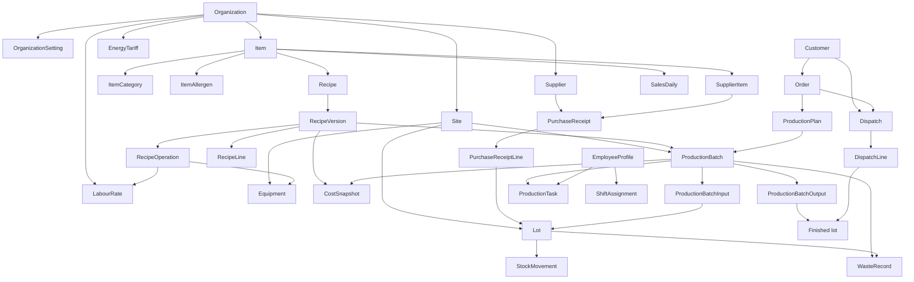
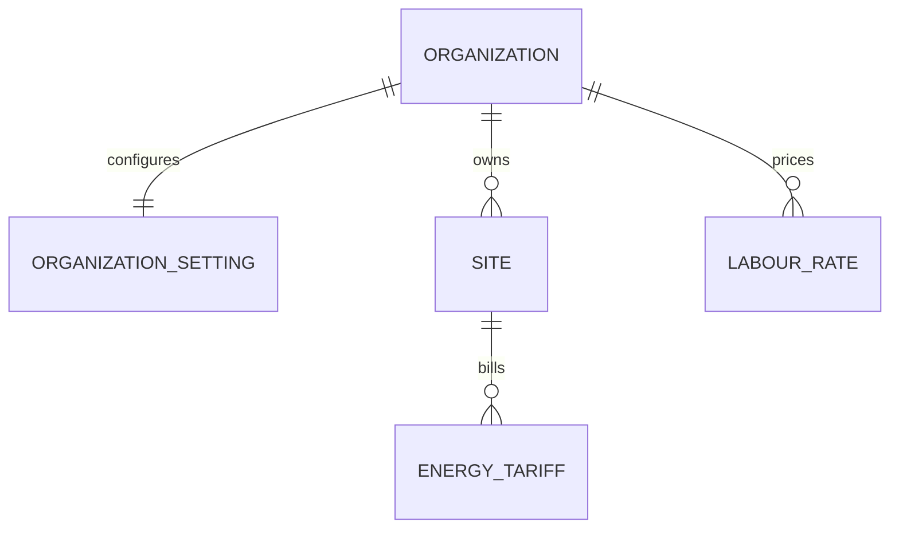
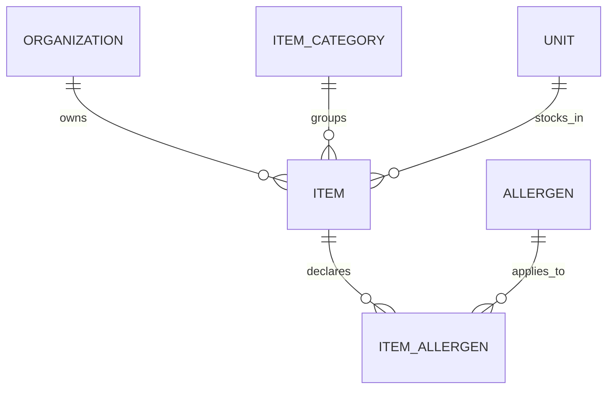
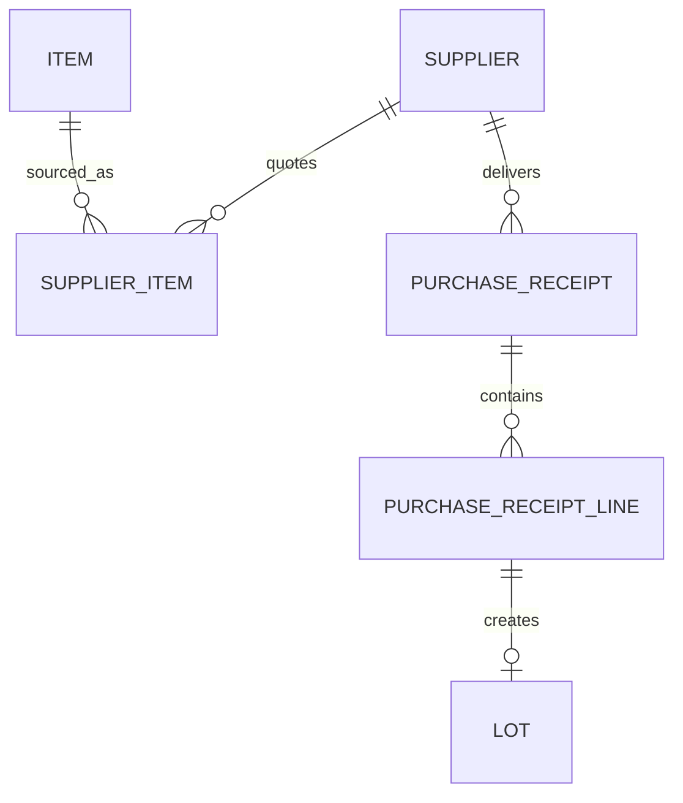
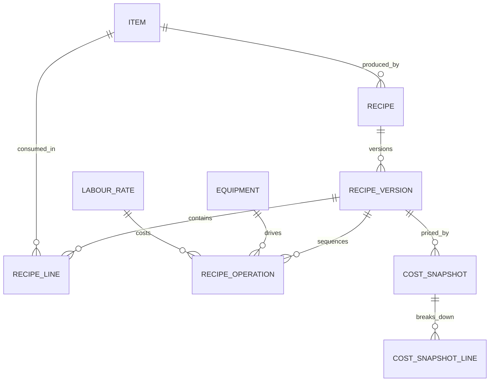
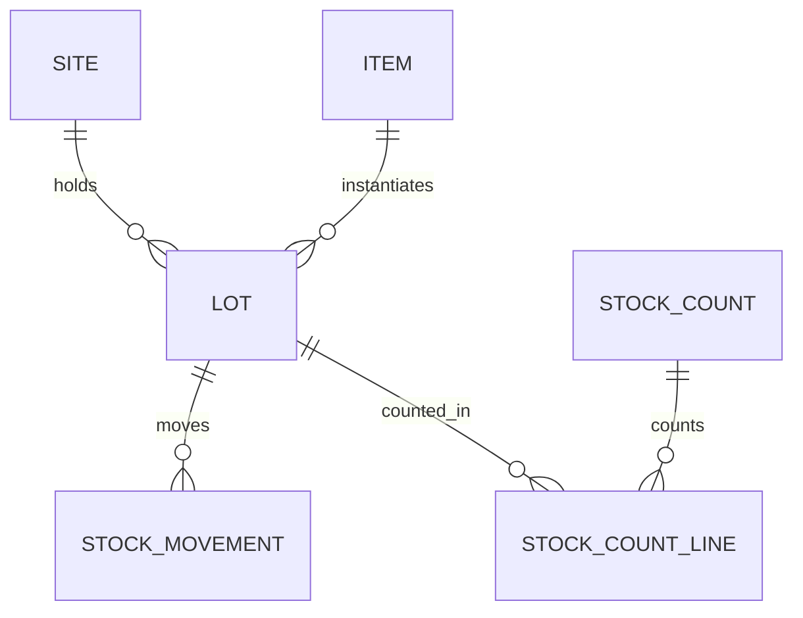
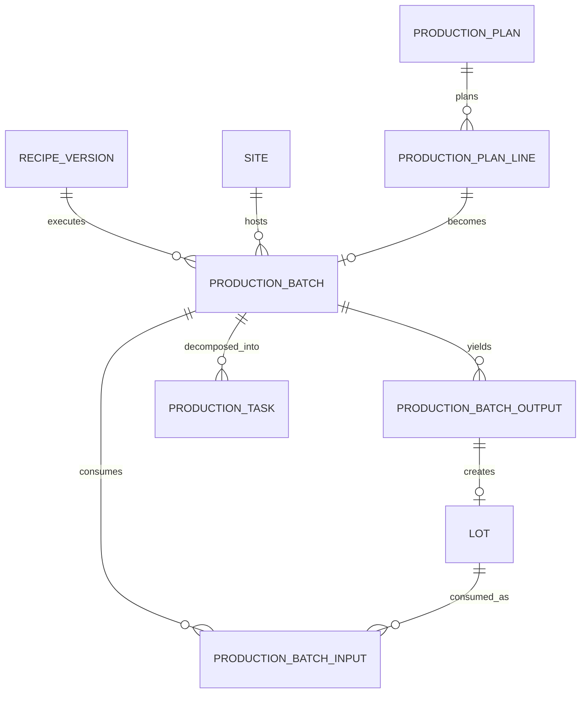
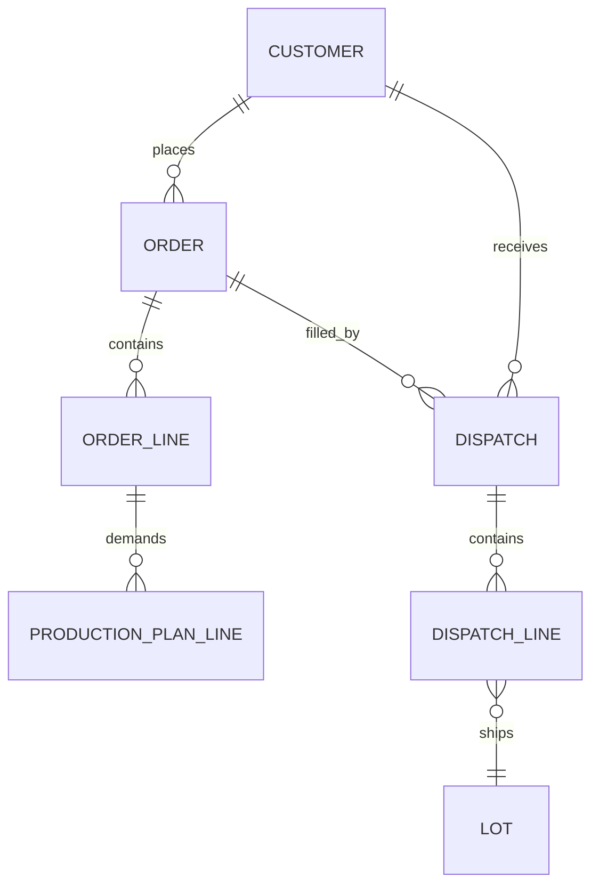
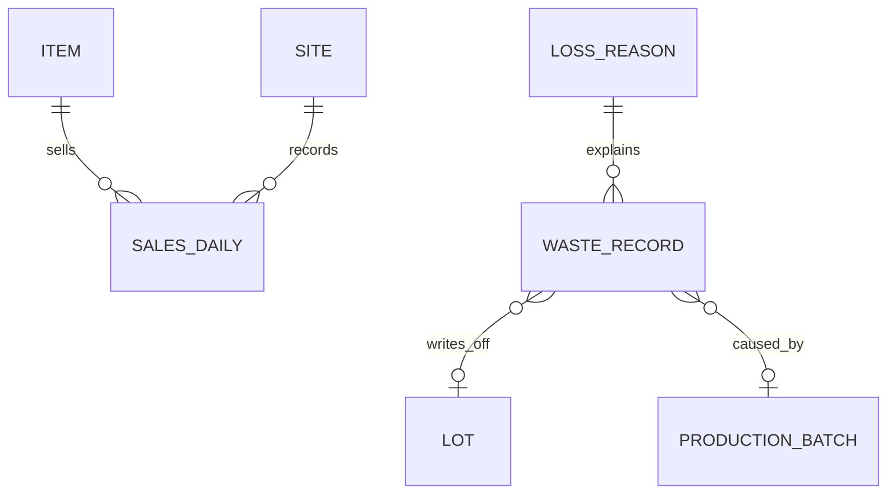
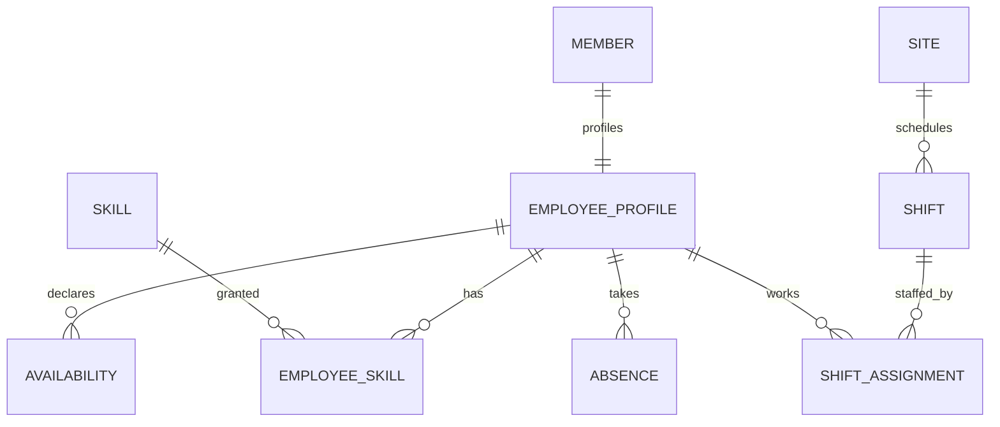

# Entity–Relationship Diagram

- Status: All three phases implemented in `prisma/schema.prisma`
- Last updated: 2026-10-26
- Companion decision: [ADR-0010](adr/0010-model-the-production-domain.md)

This document is the target relational model for Emma & Éléa. It covers every
domain in the product brief — recipes, production, raw materials, stock, cost
prices, margins and traceability — and marks each table with the phase in which
it should be built.

The seven authentication tables that already exist (`user`, `session`,
`account`, `verification`, `organization`, `member`, `invitation`) are owned by
Better Auth and are only referenced from here, never redefined. The 46 domain
tables below are new.

## How to read this document

- **Entity sections** describe one table each: its purpose, its columns, and
  the rules that cannot be expressed by a column type alone.
- **Mermaid diagrams** show cardinalities only. Column detail lives in the
  field tables, so the diagrams stay readable.
- **[Phase](#phasing)** tags say when a table should be created. Phase 1 is the
  smallest schema that can price a recipe and trace a lot from receipt to
  dispatch.
- **[Enumerations](#enumerations)** lists every enum once; entity tables refer
  to them by name.
- **[Business invariants](#business-invariants)** is the normative list. If an
  invariant is not enforceable in the database, the section says where it is
  enforced instead.

## Conventions

### Identifiers and naming

| Convention | Value |
| --- | --- |
| Primary keys | `id String @id @default(cuid(2))` |
| Foreign keys | `<model>Id String`, indexed |
| Prisma models | `PascalCase`, singular (`RecipeVersion`) |
| Tables | `snake_case`, singular (`recipe_version`), matching Better Auth's `user`, `session`, `organization` |
| Enums | `PascalCase` name, `SCREAMING_SNAKE_CASE` values (`ItemType.RAW_MATERIAL`) |
| Enums in SQL | Native PostgreSQL enums (`CREATE TYPE`) |
| Timestamps | UTC; `DateTime` carries a time, `@db.Date` carries a business date |

### Standard columns

Every table below also has:

| Column | Type | Notes |
| --- | --- | --- |
| `createdAt` | `DateTime` | `@default(now())` |
| `updatedAt` | `DateTime` | `@updatedAt`; omitted on append-only tables |

`StockMovement`, `CostSnapshot` and `CostSnapshotLine` are append-only and have
`createdAt` only. Every tenant-owned table also has `organizationId String` with
`onDelete: Cascade`; every physical table also has `siteId String`. Both are
listed explicitly in the field tables because they drive indexes and row
visibility.

### Numeric types

| Kind | Prisma | Rationale |
| --- | --- | --- |
| Money | `Decimal @db.Decimal(12, 4)` | Four decimals absorb unit prices such as €0.0187/g |
| Quantity | `Decimal @db.Decimal(14, 4)` | Grams, millilitres, pieces, dozens |
| Conversion factor | `Decimal @db.Decimal(18, 8)` | `250 g = 0.25 kg` needs the extra digits |
| Percentage | `Decimal @db.Decimal(5, 2)` | `0`–`100`, never a ratio between 0 and 1 |
| Ratio | `Decimal @db.Decimal(9, 6)` | Only for computed yields (`0.9231`) |

`Float` is forbidden for money and quantities. Every monetary aggregate also
carries a `currency String @db.VarChar(3)` snapshot, so a change of the
organization's currency never rewrites history.

### Lifecycle

- Mutable reference data (items, suppliers, customers, recipes, equipment,
  skills, events, loss reasons) uses `archivedAt DateTime?` instead of deletion.
- Transactional records (lots, movements, batches, receipts, dispatches, orders)
  are never deleted; they are cancelled or reversed.
- A hard delete is only allowed for rows that no other row references, and only
  through an explicit admin action.

### Tenant scoping

`organizationId` is stored on every tenant table even when it could be derived
through `siteId`. This keeps query filters flat, makes composite uniques
possible (`@@unique([organizationId, code])`) and leaves the door open for
PostgreSQL row-level security. `Site` is the only table whose `organizationId`
is authoritative for physical data; everything else repeats it.

## Domain map

The spine of the model is: **`Organization` → `Site` → `Item` → `Recipe` →
`RecipeVersion` → `ProductionBatch` → `Lot` → `DispatchLine` → `Customer`**.
Every feature in the brief hangs off one of those nodes.

## Tenancy and settings

Cardinalities for this domain:

### `Site` · `site` · Phase 1

A physical place where stock sits and production happens: workshop, shop,
warehouse or laboratory. One organization may have several.

| Column | Type | Null | Default | Notes |
| --- | --- | --- | --- | --- |
| `id` | `String` | no | `cuid(2)` | |
| `organizationId` | `String` | no | | → `Organization`, cascade |
| `code` | `String` | no | | Short code used in lot numbers, e.g. `ATL` |
| `name` | `String` | no | | |
| `kind` | `SiteKind` | no | `WORKSHOP` | |
| `addressLine1` | `String?` | yes | | |
| `addressLine2` | `String?` | yes | | |
| `postalCode` | `String?` | yes | | |
| `city` | `String?` | yes | | |
| `country` | `String` | no | `"FR"` | ISO 3166-1 alpha-2 |
| `timezone` | `String` | no | `"Europe/Paris"` | IANA name; drives business dates |
| `isActive` | `Boolean` | no | `true` | |
| `archivedAt` | `DateTime?` | yes | | |

- Unique: `@@unique([organizationId, code])`.
- Index: `@@index([organizationId, isActive])`.
- A site is never deleted while stock exists there; archive it instead.

### `OrganizationSetting` · `organization_setting` · Phase 1

Business configuration that must not live on Better Auth's `organization`
table, because `npm run auth:generate` regenerates it.

| Column | Type | Null | Default | Notes |
| --- | --- | --- | --- | --- |
| `id` | `String` | no | `cuid(2)` | |
| `organizationId` | `String` | no | | → `Organization`, cascade, **unique** |
| `currency` | `String` | no | `"EUR"` | ISO 4217; copied onto money-bearing aggregates |
| `overheadPct` | `Decimal(5,2)` | no | `10` | Applied to material + labour + energy |
| `defaultLabourRateId` | `String?` | yes | | → `LabourRate`, fallback when an operation has no rate |
| `forecastHistoryDays` | `Int` | no | `56` | Lookback window for quantity suggestions |
| `forecastSafetyPct` | `Decimal(5,2)` | no | `5` | Buffer applied to suggested quantities |
| `defaultShelfLifeDays` | `Int?` | yes | | Pre-fills a finished lot's expiry |
| `lotNumberPattern` | `String` | no | `"{site}-{yyMMdd}-{seq}"` | Documented, not interpreted by the DB |
| `pricesIncludeVat` | `Boolean` | no | `true` | Affects display, not stored amounts |

- One row per organization, created with the organization.
- `overheadPct` is a percentage, not a ratio.

### `EnergyTariff` · `energy_tariff` · Phase 1

Electricity and gas price per site, versioned by date, so an old batch keeps its
energy cost.

| Column | Type | Null | Default | Notes |
| --- | --- | --- | --- | --- |
| `id` | `String` | no | `cuid(2)` | |
| `organizationId` | `String` | no | | → `Organization`, cascade |
| `siteId` | `String` | no | | → `Site`, cascade |
| `energyKind` | `EnergyKind` | no | `ELECTRICITY` | |
| `pricePerKwh` | `Decimal(12,4)` | no | | |
| `currency` | `String` | no | `"EUR"` | |
| `validFrom` | `DateTime` | no | | `@db.Date` |
| `validTo` | `DateTime?` | yes | | `@db.Date`, exclusive |

- Unique: `@@unique([siteId, energyKind, validFrom])`.
- Costing picks the tariff whose range contains the production date.

### `LabourRate` · `labour_rate` · Phase 1

Hourly cost by role, versioned by date. Used by recipe operations and by batch
cost snapshots.

| Column | Type | Null | Default | Notes |
| --- | --- | --- | --- | --- |
| `id` | `String` | no | `cuid(2)` | |
| `organizationId` | `String` | no | | → `Organization`, cascade |
| `siteId` | `String?` | yes | | → `Site`; null = organization-wide |
| `label` | `String` | no | | e.g. `Pâtissier`, `Apprenti` |
| `hourlyCost` | `Decimal(12,4)` | no | | Fully loaded cost, not the gross wage |
| `currency` | `String` | no | `"EUR"` | |
| `validFrom` | `DateTime` | no | | `@db.Date` |
| `validTo` | `DateTime?` | yes | | `@db.Date`, exclusive |
| `archivedAt` | `DateTime?` | yes | | |

- Unique: `@@unique([organizationId, siteId, label, validFrom])` — null
  `siteId` is treated as organization-wide and compared in application code.
- Rates are never edited once used by a `CostSnapshot`; add a new row with a
  later `validFrom`.

## Catalogue and units

Cardinalities for this domain:

### `Unit` · `unit` · Phase 1

Global reference table, seeded by migration, not owned by a tenant. Every unit
belongs to a kind and converts to that kind's base unit.

| Column | Type | Null | Default | Notes |
| --- | --- | --- | --- | --- |
| `id` | `String` | no | `cuid(2)` | |
| `code` | `String` | no | | `kg`, `g`, `L`, `cl`, `piece`, `dozen`, `m` |
| `labelEn` | `String` | no | | `kilogram` |
| `labelFr` | `String` | no | | `kilogramme` |
| `pluralFr` | `String` | no | | `kilogrammes` |
| `kind` | `UnitKind` | no | | `MASS`, `VOLUME`, `COUNT`, `LENGTH` |
| `factorToBase` | `Decimal(18,8)` | no | | `1 g = 0.001` of the mass base (kg) |
| `isBase` | `Boolean` | no | `false` | Exactly one base unit per kind |

- Unique: `@@unique([code])`.
- Partial unique index on `isBase`:
  `CREATE UNIQUE INDEX unit_one_base_per_kind ON unit (kind) WHERE is_base;`
  Prisma cannot express a filtered unique index, so it belongs in the raw SQL
  part of the migration.
- Seed: `kg` (base, 1), `g` (0.001), `mg` (0.000001), `L` (base, 1), `cl`
  (0.01), `ml` (0.001), `piece` (base, 1), `dozen` (12), `m` (base, 1), `cm`
  (0.01).
- Labels are stored in the database rather than in `messages/*.json` because
  they are reference data that organisations may extend; UI chrome stays in
  next-intl.

### `Item` · `item` · Phase 1

Everything that is bought, stocked, transformed or sold. The single-table design
is what allows a semi-finished preparation to be both a recipe output and an
ingredient.

| Column | Type | Null | Default | Notes |
| --- | --- | --- | --- | --- |
| `id` | `String` | no | `cuid(2)` | |
| `organizationId` | `String` | no | | → `Organization`, cascade |
| `categoryId` | `String?` | yes | | → `ItemCategory` |
| `code` | `String` | no | | Unique per organization |
| `name` | `String` | no | | Localized display name |
| `description` | `String?` | yes | | |
| `type` | `ItemType` | no | | |
| `stockUnitId` | `String` | no | | → `Unit`; **must have `isBase = true`** |
| `saleUnitId` | `String?` | yes | | → `Unit`; same kind as `stockUnitId` |
| `salePrice` | `Decimal(12,4)?` | yes | | Per `saleUnitId`; null if not sold |
| `vatRate` | `Decimal(5,2)` | no | `5.50` | Percentage; food default |
| `shelfLifeDays` | `Int?` | yes | | Drives finished-lot expiry |
| `minStockQuantity` | `Decimal(14,4)?` | yes | | Replenishment alert threshold |
| `parLevelQuantity` | `Decimal(14,4)?` | yes | | Target level after replenishment |
| `defaultChannel` | `SalesChannel` | no | `RETAIL` | Guards against double-counting |
| `isPurchasable` | `Boolean` | no | `false` | |
| `isProduced` | `Boolean` | no | `false` | |
| `isSellable` | `Boolean` | no | `false` | |
| `archivedAt` | `DateTime?` | yes | | |

- Unique: `@@unique([organizationId, code])`.
- Index: `@@index([organizationId, type])`, `@@index([organizationId, categoryId])`.
- `stockUnitId` must be a base unit, so ledger arithmetic never needs a
  conversion. Recipes and receipts may express any unit of the same kind.
- `type = SEMI_FINISHED` implies `isProduced = true` and an output recipe.
- `type = PACKAGING` items appear in recipe lines with a `quantity` per yield
  unit (one box per cake) and are costed at their lot price.

### `ItemCategory` · `item_category` · Phase 1

Product family, used for "margin by family" in the brief.

| Column | Type | Null | Default | Notes |
| --- | --- | --- | --- | --- |
| `id` | `String` | no | `cuid(2)` | |
| `organizationId` | `String` | no | | → `Organization`, cascade |
| `parentId` | `String?` | yes | | → `ItemCategory`, self relation |
| `name` | `String` | no | | |
| `sortOrder` | `Int` | no | `0` | |
| `archivedAt` | `DateTime?` | yes | | |

- Unique: `@@unique([organizationId, parentId, name])`.
- PostgreSQL treats `NULL` values as distinct, so that unique key does not
  prevent two root categories with the same name. Add the partial index
  `CREATE UNIQUE INDEX item_category_root_name ON item_category (organization_id, name) WHERE parent_id IS NULL;`.
- Depth is limited to two levels in the application; no cycles.

### `Allergen` · `allergen` · Phase 1

The 14 EU allergens, seeded globally.

| Column | Type | Null | Default | Notes |
| --- | --- | --- | --- | --- |
| `id` | `String` | no | `cuid(2)` | |
| `code` | `String` | no | | `GLUTEN`, `CRUSTACEANS`, … |
| `labelEn` | `String` | no | | |
| `labelFr` | `String` | no | | |
| `sortOrder` | `Int` | no | `0` | |

- Unique: `@@unique([code])`.

### `ItemAllergen` · `item_allergen` · Phase 1

Declares which allergens an item carries. Recipe allergen sheets are derived
from these rows; they are never typed per recipe.

| Column | Type | Null | Default | Notes |
| --- | --- | --- | --- | --- |
| `id` | `String` | no | `cuid(2)` | |
| `organizationId` | `String` | no | | → `Organization`, cascade |
| `itemId` | `String` | no | | → `Item`, cascade |
| `allergenId` | `String` | no | | → `Allergen` |
| `presence` | `AllergenPresence` | no | `CONTAINS` | |
| `note` | `String?` | yes | | e.g. `same line as nuts` |

- Unique: `@@unique([itemId, allergenId, presence])`.
- `MAY_CONTAIN` does not propagate to recipes as `CONTAINS`, but is shown on
  the sheet.

## Purchasing

Cardinalities for this domain:

### `Supplier` · `supplier` · Phase 1

| Column | Type | Null | Default | Notes |
| --- | --- | --- | --- | --- |
| `id` | `String` | no | `cuid(2)` | |
| `organizationId` | `String` | no | | → `Organization`, cascade |
| `code` | `String` | no | | |
| `name` | `String` | no | | |
| `contactName` | `String?` | yes | | |
| `email` | `String?` | yes | | |
| `phone` | `String?` | yes | | |
| `addressLine1` | `String?` | yes | | |
| `postalCode` | `String?` | yes | | |
| `city` | `String?` | yes | | |
| `country` | `String` | no | `"FR"` | |
| `defaultLeadTimeDays` | `Int?` | yes | | Fallback for `SupplierItem` |
| `note` | `String?` | yes | | |
| `archivedAt` | `DateTime?` | yes | | |

- Unique: `@@unique([organizationId, code])`.

### `SupplierItem` · `supplier_item` · Phase 1

The supplier's view of one item: their reference, their pack size, their price.
This is what makes "compare suppliers" and "pack size" possible.

| Column | Type | Null | Default | Notes |
| --- | --- | --- | --- | --- |
| `id` | `String` | no | `cuid(2)` | |
| `organizationId` | `String` | no | | → `Organization`, cascade |
| `supplierId` | `String` | no | | → `Supplier`, cascade |
| `itemId` | `String` | no | | → `Item`, cascade |
| `supplierRef` | `String?` | yes | | Supplier's catalogue number |
| `packQuantity` | `Decimal(14,4)` | no | | e.g. `25` |
| `packUnitId` | `String` | no | | → `Unit`, e.g. `kg` |
| `price` | `Decimal(12,4)` | no | | Per pack, excluding VAT |
| `currency` | `String` | no | `"EUR"` | |
| `leadTimeDays` | `Int?` | yes | | Overrides `Supplier.defaultLeadTimeDays` |
| `minOrderQuantity` | `Decimal(14,4)?` | yes | | In packs |
| `isPreferred` | `Boolean` | no | `false` | |
| `validFrom` | `DateTime` | no | | `@db.Date` |
| `validTo` | `DateTime?` | yes | | `@db.Date` |
| `archivedAt` | `DateTime?` | yes | | |

- Unique: `@@unique([supplierId, itemId, validFrom])`.
- Index: `@@index([organizationId, itemId, isPreferred])`.
- Price history is read from `SupplierItem` versions and, for actual paid
  prices, from `PurchaseReceiptLine`.

### `PurchaseReceipt` · `purchase_receipt` · Phase 1

A goods receipt — what actually arrived, when, from whom. Purchase orders are
deliberately out of scope until Phase 2.

| Column | Type | Null | Default | Notes |
| --- | --- | --- | --- | --- |
| `id` | `String` | no | `cuid(2)` | |
| `organizationId` | `String` | no | | → `Organization`, cascade |
| `siteId` | `String` | no | | → `Site` |
| `supplierId` | `String` | no | | → `Supplier` |
| `number` | `String` | no | | Internal document number |
| `supplierReference` | `String?` | yes | | Delivery note or invoice number |
| `status` | `ReceiptStatus` | no | `DRAFT` | |
| `receivedAt` | `DateTime?` | yes | | Required when `POSTED` |
| `currency` | `String` | no | `"EUR"` | |
| `totalAmount` | `Decimal(12,4)` | no | `0` | Sum of posted lines, excluding VAT |
| `note` | `String?` | yes | | |
| `receivedById` | `String?` | yes | | → `User`, `SetNull` |

- Unique: `@@unique([organizationId, number])`.
- Index: `@@index([siteId, receivedAt])`.
- Posting the receipt creates one `Lot` and one `RECEIPT` `StockMovement`
  per line, in a single transaction.

### `PurchaseReceiptLine` · `purchase_receipt_line` · Phase 1

| Column | Type | Null | Default | Notes |
| --- | --- | --- | --- | --- |
| `id` | `String` | no | `cuid(2)` | |
| `organizationId` | `String` | no | | → `Organization`, cascade |
| `purchaseReceiptId` | `String` | no | | → `PurchaseReceipt`, cascade |
| `itemId` | `String` | no | | → `Item` |
| `supplierItemId` | `String?` | yes | | → `SupplierItem` |
| `quantity` | `Decimal(14,4)` | no | | In `unitId` |
| `unitId` | `String` | no | | → `Unit`; same kind as the item's stock unit |
| `unitPrice` | `Decimal(12,4)` | no | | Per `unitId`, excluding VAT |
| `lineTotal` | `Decimal(12,4)` | no | | Stored, not generated, to survive price edits |
| `lotNumber` | `String?` | yes | | Supplier lot; generated if absent |
| `supplierLotNumber` | `String?` | yes | | Kept separately for traceability |
| `expiresOn` | `DateTime?` | yes | | `@db.Date`, DLC |
| `bestBeforeOn` | `DateTime?` | yes | | `@db.Date`, DDM |
| `note` | `String?` | yes | | |

- Index: `@@index([purchaseReceiptId])`, `@@index([itemId])`.
- `lineTotal = quantity × unitPrice` is enforced in application code so a
  rounding change does not need a migration.
- The lot created from a line is found through `Lot.purchaseReceiptLineId`.

## Recipes and costing

Cardinalities for this domain:

### `Recipe` · `recipe` · Phase 1

The identity of a recipe: what it produces, its name, and which version is
current.

| Column | Type | Null | Default | Notes |
| --- | --- | --- | --- | --- |
| `id` | `String` | no | `cuid(2)` | |
| `organizationId` | `String` | no | | → `Organization`, cascade |
| `outputItemId` | `String` | no | | → `Item`; must be `SEMI_FINISHED` or `FINISHED_PRODUCT` |
| `currentVersionId` | `String?` | yes | | → `RecipeVersion`, **unique**, relation `RecipeCurrentVersion` |
| `code` | `String` | no | | |
| `name` | `String` | no | | |
| `description` | `String?` | yes | | |
| `isDefault` | `Boolean` | no | `true` | Default recipe for `outputItemId` |
| `archivedAt` | `DateTime?` | yes | | |

- Unique: `@@unique([organizationId, code])`.
- Index: `@@index([organizationId, outputItemId, isDefault])`.
- `currentVersionId` and `RecipeVersion.recipeId` form a cycle; Prisma needs
  the forward side nullable and named (`@relation("RecipeCurrentVersion")`).
- `currentVersionId` must point to a version whose `status = PUBLISHED` and
  whose `recipeId` is this recipe.

### `RecipeVersion` · `recipe_version` · Phase 1

Immutable content of a recipe. Editing publishes a new version; nothing that
references a version is ever rewritten.

| Column | Type | Null | Default | Notes |
| --- | --- | --- | --- | --- |
| `id` | `String` | no | `cuid(2)` | |
| `organizationId` | `String` | no | | → `Organization`, cascade |
| `recipeId` | `String` | no | | → `Recipe`, cascade |
| `versionNumber` | `Int` | no | | Starts at 1, increments per recipe |
| `status` | `RecipeVersionStatus` | no | `DRAFT` | |
| `yieldQuantity` | `Decimal(14,4)` | no | | Output quantity per batch |
| `yieldUnitId` | `String` | no | | → `Unit`; must match the output item's kind |
| `portionCount` | `Int?` | yes | | For portioned products |
| `prepMinutes` | `Int?` | yes | | Aggregate; detail lives in `RecipeOperation` |
| `cookMinutes` | `Int?` | yes | | Aggregate |
| `instructions` | `String?` | yes | | Markdown |
| `changeNote` | `String?` | yes | | Why this version exists |
| `publishedAt` | `DateTime?` | yes | | Set on transition to `PUBLISHED` |
| `createdById` | `String?` | yes | | → `User`, `SetNull` |

- Unique: `@@unique([recipeId, versionNumber])`.
- Partial unique index (raw SQL in the migration): at most one `PUBLISHED`
  version per recipe:
  `CREATE UNIQUE INDEX recipe_version_one_published ON recipe_version (recipe_id) WHERE status = 'PUBLISHED';`
- A `PUBLISHED` version is immutable: only `status` may change, to `ARCHIVED`.
- Copying a version copies its lines and operations, not its snapshots.

### `RecipeLine` · `recipe_line` · Phase 1

One ingredient, packaging item or semi-finished preparation in a version.

| Column | Type | Null | Default | Notes |
| --- | --- | --- | --- | --- |
| `id` | `String` | no | `cuid(2)` | |
| `organizationId` | `String` | no | | → `Organization`, cascade |
| `recipeVersionId` | `String` | no | | → `RecipeVersion`, cascade |
| `itemId` | `String` | no | | → `Item` |
| `quantity` | `Decimal(14,4)` | no | | For `yieldQuantity` of output |
| `unitId` | `String` | no | | → `Unit`; same kind as the item's stock unit |
| `lossPct` | `Decimal(5,2)` | no | `0` | Trimming, evaporation, sticking |
| `isOptional` | `Boolean` | no | `false` | Not counted in the base cost |
| `position` | `Int` | no | `0` | Display and weighing order |
| `note` | `String?` | yes | | |

- Unique: `@@unique([recipeVersionId, position])`.
- Index: `@@index([itemId])` for "where is this item used?".
- `itemId` must not equal the recipe's `outputItemId`, directly or through a
  chain of semi-finished items.

### `RecipeOperation` · `recipe_operation` · Phase 1

A step. It supplies labour time, energy time, the instructions shown on the
shop floor, and the shape of a `ProductionTask`.

| Column | Type | Null | Default | Notes |
| --- | --- | --- | --- | --- |
| `id` | `String` | no | `cuid(2)` | |
| `organizationId` | `String` | no | | → `Organization`, cascade |
| `recipeVersionId` | `String` | no | | → `RecipeVersion`, cascade |
| `equipmentId` | `String?` | yes | | → `Equipment`; null = no equipment |
| `labourRateId` | `String?` | yes | | → `LabourRate`; null = organization default |
| `position` | `Int` | no | `0` | |
| `name` | `String` | no | | `Pétrissage`, `Cuisson` |
| `description` | `String?` | yes | | |
| `durationMinutes` | `Int` | no | | Active + passive time |
| `activeMinutes` | `Int?` | yes | | Labour time; defaults to `durationMinutes` |
| `temperatureC` | `Decimal(5,2)?` | yes | | |
| `estimatedQuantity` | `Decimal(14,4)?` | yes | | e.g. dough weight moved |

- Unique: `@@unique([recipeVersionId, position])`.
- Energy cost = `Equipment.powerKw × durationMinutes / 60 × tariff.pricePerKwh`
  for the tariff valid on the production date.
- Labour cost = `activeMinutes / 60 × labourRate.hourlyCost`.

### `Equipment` · `equipment` · Phase 1

| Column | Type | Null | Default | Notes |
| --- | --- | --- | --- | --- |
| `id` | `String` | no | `cuid(2)` | |
| `organizationId` | `String` | no | | → `Organization`, cascade |
| `siteId` | `String?` | yes | | → `Site`; null = shared |
| `name` | `String` | no | | `Four 1`, `Batteur 20 L` |
| `kind` | `EquipmentKind` | no | `OTHER` | |
| `powerKw` | `Decimal(8,3)?` | yes | | Null = no energy cost |
| `note` | `String?` | yes | | |
| `archivedAt` | `DateTime?` | yes | | |

- Index: `@@index([organizationId, siteId])`.

### `CostSnapshot` · `cost_snapshot` · Phase 1

A stored costing run. The brief promises that a price change updates margins,
and that past costs stay explainable; storing the result is the only way to do
both.

| Column | Type | Null | Default | Notes |
| --- | --- | --- | --- | --- |
| `id` | `String` | no | `cuid(2)` | |
| `organizationId` | `String` | no | | → `Organization`, cascade |
| `siteId` | `String?` | yes | | → `Site`; set for batch snapshots |
| `scope` | `CostScope` | no | | `RECIPE_VERSION` or `PRODUCTION_BATCH` |
| `recipeVersionId` | `String?` | yes | | → `RecipeVersion` |
| `productionBatchId` | `String?` | yes | | → `ProductionBatch` |
| `computedAt` | `DateTime` | no | `now()` | |
| `currency` | `String` | no | `"EUR"` | |
| `materialCost` | `Decimal(12,4)` | no | | Ingredients, loss-adjusted |
| `packagingCost` | `Decimal(12,4)` | no | | |
| `labourCost` | `Decimal(12,4)` | no | | |
| `energyCost` | `Decimal(12,4)` | no | | |
| `overheadCost` | `Decimal(12,4)` | no | | `overheadPct × (material + packaging + labour + energy)` |
| `totalCost` | `Decimal(12,4)` | no | | Sum of the five components |
| `yieldQuantity` | `Decimal(14,4)` | no | | Output actually costed |
| `yieldUnitId` | `String` | no | | → `Unit` |
| `costPerUnit` | `Decimal(12,4)` | no | | `totalCost / yieldQuantity` |
| `salePrice` | `Decimal(12,4)?` | yes | | Copied at computation time |
| `marginPct` | `Decimal(5,2)?` | yes | | `(salePrice − costPerUnit) / salePrice × 100` |
| `inputHash` | `String?` | yes | | Dedupe key over prices, rates and lines |
| `createdById` | `String?` | yes | | → `User`, `SetNull` |

- Index: `@@index([organizationId, recipeVersionId, computedAt])`,
  `@@index([productionBatchId])`.
- Exactly one of `recipeVersionId` / `productionBatchId` is set, matching
  `scope`; enforce with a `CHECK`.
- The latest snapshot for a batch is the authoritative cost of that batch, even
  if a lot price is later corrected.

### `CostSnapshotLine` · `cost_snapshot_line` · Phase 1

Why a cost is what it is. One row per ingredient, operation, tariff or overhead
application.

| Column | Type | Null | Default | Notes |
| --- | --- | --- | --- | --- |
| `id` | `String` | no | `cuid(2)` | |
| `organizationId` | `String` | no | | → `Organization`, cascade |
| `costSnapshotId` | `String` | no | | → `CostSnapshot`, cascade |
| `kind` | `CostLineKind` | no | | `MATERIAL`, `PACKAGING`, `LABOUR`, `ENERGY`, `OVERHEAD` |
| `itemId` | `String?` | yes | | → `Item` |
| `lotId` | `String?` | yes | | → `Lot`; which lot was actually consumed |
| `recipeOperationId` | `String?` | yes | | → `RecipeOperation` |
| `label` | `String` | no | | Human-readable, denormalised |
| `quantity` | `Decimal(14,4)?` | yes | | |
| `unitId` | `String?` | yes | | → `Unit` |
| `unitCost` | `Decimal(12,4)?` | yes | | Price captured at computation time |
| `amount` | `Decimal(12,4)` | no | | Contribution to the total |
| `position` | `Int` | no | `0` | |

- Index: `@@index([costSnapshotId, kind, position])`.
- `label` and `unitCost` are copied, not joined, so a snapshot stays readable
  after an item is renamed.

## Stock and traceability

Cardinalities for this domain:

### `Lot` · `lot` · Phase 1

A physical batch of an item at a site. Every quantity in the system eventually
belongs to a lot.

| Column | Type | Null | Default | Notes |
| --- | --- | --- | --- | --- |
| `id` | `String` | no | `cuid(2)` | |
| `organizationId` | `String` | no | | → `Organization`, cascade |
| `siteId` | `String` | no | | → `Site` |
| `itemId` | `String` | no | | → `Item` |
| `purchaseReceiptLineId` | `String?` | yes | | → `PurchaseReceiptLine`, **unique** |
| `productionBatchId` | `String?` | yes | | → `ProductionBatch`; set for produced lots |
| `lotNumber` | `String` | no | | Internal, printed on labels |
| `supplierLotNumber` | `String?` | yes | | As printed by the supplier |
| `receivedAt` | `DateTime` | no | | |
| `producedOn` | `DateTime?` | yes | | `@db.Date` |
| `expiresOn` | `DateTime?` | yes | | `@db.Date`, DLC |
| `bestBeforeOn` | `DateTime?` | yes | | `@db.Date`, DDM |
| `quantityReceived` | `Decimal(14,4)` | no | | In the item's stock unit |
| `quantityRemaining` | `Decimal(14,4)` | no | | Cache of the movement ledger |
| `unitCost` | `Decimal(12,4)` | no | | Weighted actual cost on receipt |
| `currency` | `String` | no | `"EUR"` | |
| `status` | `LotStatus` | no | `AVAILABLE` | |
| `note` | `String?` | yes | | |

- Unique: `@@unique([organizationId, siteId, itemId, lotNumber])`.
- Index: `@@index([siteId, expiresOn])`, `@@index([organizationId, itemId, status])`.
- `quantityRemaining` is a cache. It is authoritative only after
  `SELECT sum(quantity)` over the lot's movements, which is the reconciliation
  query used by `StockCount`.
- A lot with movements cannot be deleted or have its item changed.

### `StockMovement` · `stock_movement` · Phase 1

Append-only ledger. Signed quantity in the item's stock unit.

| Column | Type | Null | Default | Notes |
| --- | --- | --- | --- | --- |
| `id` | `String` | no | `cuid(2)` | |
| `organizationId` | `String` | no | | → `Organization`, cascade |
| `siteId` | `String` | no | | → `Site` |
| `itemId` | `String` | no | | → `Item` |
| `lotId` | `String?` | yes | | → `Lot`; null for item-level adjustments |
| `type` | `StockMovementType` | no | | |
| `quantity` | `Decimal(14,4)` | no | | Signed: positive in, negative out |
| `unitId` | `String` | no | | → `Unit`; always the item's stock unit |
| `occurredAt` | `DateTime` | no | `now()` | |
| `referenceType` | `StockReferenceType?` | yes | | Polymorphic discriminator |
| `referenceId` | `String?` | yes | | Id of the referenced row, not an FK |
| `reason` | `String?` | yes | | Free text for manual movements |
| `createdById` | `String?` | yes | | → `User`, `SetNull` |
| `createdAt` | `DateTime` | no | `now()` | |

- Index: `@@index([organizationId, itemId, occurredAt])`,
  `@@index([lotId, occurredAt])`, `@@index([referenceType, referenceId])`.
- `(referenceType, referenceId)` is a soft reference, because the target table
  varies. Integrity is enforced by the application and by the `CHECK` that both
  columns are null or both set.
- The table is append-only: `UPDATE` is rejected by a database trigger, and the
  application exposes no delete path. A correction is a new movement of the
  opposite sign with a `reason`.
- Posting rules: a `RECEIPT` is positive; `CONSUMPTION`, `WASTE` and `DISPATCH`
  are negative; `PRODUCTION_OUTPUT` is positive; `ADJUSTMENT` and `COUNT` may
  be either.

### `StockCount` · `stock_count` · Phase 3

Physical inventory session.

| Column | Type | Null | Default | Notes |
| --- | --- | --- | --- | --- |
| `id` | `String` | no | `cuid(2)` | |
| `organizationId` | `String` | no | | → `Organization`, cascade |
| `siteId` | `String` | no | | → `Site` |
| `status` | `StockCountStatus` | no | `DRAFT` | |
| `countedAt` | `DateTime` | no | | `@db.Date` |
| `postedAt` | `DateTime?` | yes | | |
| `countedById` | `String?` | yes | | → `User`, `SetNull` |
| `note` | `String?` | yes | | |

- Index: `@@index([siteId, countedAt])`.

### `StockCountLine` · `stock_count_line` · Phase 3

| Column | Type | Null | Default | Notes |
| --- | --- | --- | --- | --- |
| `id` | `String` | no | `cuid(2)` | |
| `organizationId` | `String` | no | | → `Organization`, cascade |
| `stockCountId` | `String` | no | | → `StockCount`, cascade |
| `itemId` | `String` | no | | → `Item` |
| `lotId` | `String?` | yes | | → `Lot` |
| `expectedQuantity` | `Decimal(14,4)` | no | | Ledger sum at session start |
| `countedQuantity` | `Decimal(14,4)` | no | | Physical count |
| `variance` | `Decimal(14,4)` | no | | `counted − expected` |
| `unitId` | `String` | no | | → `Unit` |
| `note` | `String?` | yes | | |

- Unique: `@@unique([stockCountId, lotId])`.
- A `NULL` `lotId` means an item-level count, not a lot count; the application
  permits at most one such row per item and session.
- Posting a count writes one `COUNT` movement per non-zero variance;
  `src/lib/stock-count.ts` builds those drafts and is unit-tested.

## Production

Cardinalities for this domain:

### `ProductionPlan` · `production_plan` · Phase 2

What the workshop intends to make on a given day, before anything is executed.

| Column | Type | Null | Default | Notes |
| --- | --- | --- | --- | --- |
| `id` | `String` | no | `cuid(2)` | |
| `organizationId` | `String` | no | | → `Organization`, cascade |
| `siteId` | `String` | no | | → `Site` |
| `plannedFor` | `DateTime` | no | | `@db.Date` |
| `status` | `PlanStatus` | no | `DRAFT` | |
| `source` | `PlanSource` | no | `MANUAL` | |
| `note` | `String?` | yes | | |

- Unique: `@@unique([siteId, plannedFor, status])` is not usable because
  several plans may be closed on the same day; use
  `@@index([siteId, plannedFor])` and enforce one open plan per site/day in the
  application.

### `ProductionPlanLine` · `production_plan_line` · Phase 2

| Column | Type | Null | Default | Notes |
| --- | --- | --- | --- | --- |
| `id` | `String` | no | `cuid(2)` | |
| `organizationId` | `String` | no | | → `Organization`, cascade |
| `productionPlanId` | `String` | no | | → `ProductionPlan`, cascade |
| `itemId` | `String` | no | | → `Item` |
| `recipeId` | `String?` | yes | | → `Recipe`; default recipe if null |
| `orderLineId` | `String?` | yes | | → `OrderLine`; set when the line is demand-driven |
| `plannedQuantity` | `Decimal(14,4)` | no | | |
| `unitId` | `String` | no | | → `Unit` |
| `note` | `String?` | yes | | |

- Unique: `@@unique([productionPlanId, itemId, orderLineId])`.
- `orderLineId` is nullable, so PostgreSQL allows several forecast-driven lines
  for the same item. The application keeps at most one non-order line per item
  and merges manual additions into it.

### `ProductionBatch` · `production_batch` · Phase 1

One real execution of a recipe version. This is the unit that traceability and
batch costing attach to.

| Column | Type | Null | Default | Notes |
| --- | --- | --- | --- | --- |
| `id` | `String` | no | `cuid(2)` | |
| `organizationId` | `String` | no | | → `Organization`, cascade |
| `siteId` | `String` | no | | → `Site` |
| `recipeVersionId` | `String` | no | | → `RecipeVersion`; **pins the version** |
| `productionPlanLineId` | `String?` | yes | | → `ProductionPlanLine`, unique |
| `code` | `String` | no | | Batch number |
| `status` | `BatchStatus` | no | `PLANNED` | |
| `plannedQuantity` | `Decimal(14,4)` | no | | |
| `actualQuantity` | `Decimal(14,4)?` | yes | | Required when `COMPLETED` |
| `unitId` | `String` | no | | → `Unit` |
| `plannedStartAt` | `DateTime?` | yes | | |
| `startedAt` | `DateTime?` | yes | | |
| `completedAt` | `DateTime?` | yes | | |
| `producedOn` | `DateTime?` | yes | | `@db.Date`, drives expiry and costing |
| `operatorId` | `String?` | yes | | → `EmployeeProfile`, `SetNull` |
| `note` | `String?` | yes | | |

- Unique: `@@unique([organizationId, code])`.
- Index: `@@index([siteId, producedOn])`, `@@index([recipeVersionId])`.
- `yieldPct` is computed, not stored: `actualQuantity / plannedQuantity × 100`.
- Completing a batch, in one transaction: writes `ProductionBatchInput` rows,
  negative `CONSUMPTION` movements, creates output lots, positive
  `PRODUCTION_OUTPUT` movements, and a `PRODUCTION_BATCH` `CostSnapshot`.
- A batch in `COMPLETED` status is immutable except for notes and tasks.

### `ProductionBatchInput` · `production_batch_input` · Phase 1

What was actually consumed, and what the recipe said should be consumed. The
difference is where waste and over-portioning show up.

| Column | Type | Null | Default | Notes |
| --- | --- | --- | --- | --- |
| `id` | `String` | no | `cuid(2)` | |
| `organizationId` | `String` | no | | → `Organization`, cascade |
| `productionBatchId` | `String` | no | | → `ProductionBatch`, cascade |
| `lotId` | `String` | no | | → `Lot` |
| `itemId` | `String` | no | | → `Item`, denormalised from the lot |
| `quantity` | `Decimal(14,4)` | no | | Actual consumed |
| `theoreticalQuantity` | `Decimal(14,4)?` | yes | | Recipe expectation, loss-adjusted |
| `unitId` | `String` | no | | → `Unit` |
| `unitCost` | `Decimal(12,4)` | no | | From the lot at consumption time |
| `note` | `String?` | yes | | |

- Unique: `@@unique([productionBatchId, lotId])`.
- Index: `@@index([lotId])` for forward traceability.

### `ProductionBatchOutput` · `production_batch_output` · Phase 1

What came out. Usually one primary lot; co-products and by-products are
additional rows.

| Column | Type | Null | Default | Notes |
| --- | --- | --- | --- | --- |
| `id` | `String` | no | `cuid(2)` | |
| `organizationId` | `String` | no | | → `Organization`, cascade |
| `productionBatchId` | `String` | no | | → `ProductionBatch`, cascade |
| `itemId` | `String` | no | | → `Item` |
| `lotId` | `String?` | yes | | → `Lot`; null while the batch is planned |
| `quantity` | `Decimal(14,4)` | no | | |
| `unitId` | `String` | no | | → `Unit` |
| `isPrimary` | `Boolean` | no | `false` | Exactly one per completed batch |
| `costPerUnit` | `Decimal(12,4)?` | yes | | Share of the batch cost |
| `note` | `String?` | yes | | |

- Unique: `@@unique([productionBatchId, lotId])`; PostgreSQL allows several
  NULL `lotId`s, so the single-primary rule is enforced in application code.
- Co-product cost allocation is by sales value when every output has a price,
  otherwise by quantity. The rule is stored in `note` on the snapshot, not
  hard-coded in the schema.

### `ProductionTask` · `production_task` · Phase 2

The "who makes what, when" unit. Assigned to a `ProductionBatch` and,
optionally, to an employee.

| Column | Type | Null | Default | Notes |
| --- | --- | --- | --- | --- |
| `id` | `String` | no | `cuid(2)` | |
| `organizationId` | `String` | no | | → `Organization`, cascade |
| `productionBatchId` | `String?` | yes | | → `ProductionBatch`, cascade |
| `requiredSkillId` | `String?` | yes | | → `Skill` |
| `assignedEmployeeId` | `String?` | yes | | → `EmployeeProfile`, `SetNull` |
| `title` | `String` | no | | Defaults to the operation name |
| `description` | `String?` | yes | | |
| `status` | `TaskStatus` | no | `TODO` | |
| `estimatedMinutes` | `Int?` | yes | | Copied from `RecipeOperation` |
| `plannedStartAt` | `DateTime?` | yes | | |
| `plannedEndAt` | `DateTime?` | yes | | |
| `position` | `Int` | no | `0` | |

- Index: `@@index([organizationId, plannedStartAt])`,
  `@@index([assignedEmployeeId, status])`.
- Assignment must satisfy `EmployeeSkill` for `requiredSkillId`; enforced in
  application code so a supervisor can override with a warning.

## Commercial

Cardinalities for this domain:

### `Customer` · `customer` · Phase 2

| Column | Type | Null | Default | Notes |
| --- | --- | --- | --- | --- |
| `id` | `String` | no | `cuid(2)` | |
| `organizationId` | `String` | no | | → `Organization`, cascade |
| `code` | `String?` | yes | | Optional internal reference |
| `name` | `String` | no | | |
| `type` | `CustomerType` | no | `BUSINESS` | |
| `contactName` | `String?` | yes | | |
| `email` | `String?` | yes | | |
| `phone` | `String?` | yes | | |
| `addressLine1` | `String?` | yes | | |
| `postalCode` | `String?` | yes | | |
| `city` | `String?` | yes | | |
| `country` | `String` | no | `"FR"` | |
| `vatNumber` | `String?` | yes | | |
| `note` | `String?` | yes | | |
| `archivedAt` | `DateTime?` | yes | | |

- Unique: `@@unique([organizationId, code])` where `code` is not null.
- Index: `@@index([organizationId, name])`.

### `Order` · `order` · Phase 2

| Column | Type | Null | Default | Notes |
| --- | --- | --- | --- | --- |
| `id` | `String` | no | `cuid(2)` | |
| `organizationId` | `String` | no | | → `Organization`, cascade |
| `siteId` | `String` | no | | → `Site` |
| `customerId` | `String` | no | | → `Customer` |
| `number` | `String` | no | | |
| `status` | `OrderStatus` | no | `DRAFT` | |
| `requestedFor` | `DateTime` | no | | Pickup or delivery date |
| `currency` | `String` | no | `"EUR"` | |
| `totalAmount` | `Decimal(12,4)` | no | `0` | Excluding VAT |
| `note` | `String?` | yes | | |

- Unique: `@@unique([organizationId, number])`.
- Index: `@@index([siteId, requestedFor, status])`.
- Confirming an order feeds `ProductionPlanLine.orderLineId`.

### `OrderLine` · `order_line` · Phase 2

| Column | Type | Null | Default | Notes |
| --- | --- | --- | --- | --- |
| `id` | `String` | no | `cuid(2)` | |
| `organizationId` | `String` | no | | → `Organization`, cascade |
| `orderId` | `String` | no | | → `Order`, cascade |
| `itemId` | `String` | no | | → `Item` |
| `quantity` | `Decimal(14,4)` | no | | |
| `unitId` | `String` | no | | → `Unit` |
| `unitPrice` | `Decimal(12,4)` | no | | Excluding VAT |
| `fulfilledQuantity` | `Decimal(14,4)` | no | `0` | Updated by dispatches |
| `note` | `String?` | yes | | |

- Index: `@@index([orderId])`.

### `Dispatch` · `dispatch` · Phase 2

A delivery note. This is the B2B channel that makes a recall answerable.

| Column | Type | Null | Default | Notes |
| --- | --- | --- | --- | --- |
| `id` | `String` | no | `cuid(2)` | |
| `organizationId` | `String` | no | | → `Organization`, cascade |
| `siteId` | `String` | no | | → `Site` |
| `customerId` | `String?` | yes | | → `Customer`; null for internal transfers |
| `orderId` | `String?` | yes | | → `Order` |
| `number` | `String` | no | | |
| `status` | `DispatchStatus` | no | `DRAFT` | |
| `dispatchedAt` | `DateTime?` | yes | | Required when `DISPATCHED` |
| `carrier` | `String?` | yes | | |
| `note` | `String?` | yes | | |

- Unique: `@@unique([organizationId, number])`.
- Index: `@@index([siteId, dispatchedAt])`, `@@index([customerId])`.
- Posting writes one negative `DISPATCH` movement per line.

### `DispatchLine` · `dispatch_line` · Phase 2

The traceability edge. `lotId` is mandatory here, unlike every other line
table, because the whole point of the row is to record which lot left the
building.

| Column | Type | Null | Default | Notes |
| --- | --- | --- | --- | --- |
| `id` | `String` | no | `cuid(2)` | |
| `organizationId` | `String` | no | | → `Organization`, cascade |
| `dispatchId` | `String` | no | | → `Dispatch`, cascade |
| `itemId` | `String` | no | | → `Item` |
| `lotId` | `String` | no | | → `Lot`, **required** |
| `quantity` | `Decimal(14,4)` | no | | |
| `unitId` | `String` | no | | → `Unit` |
| `unitPrice` | `Decimal(12,4)?` | yes | | |
| `note` | `String?` | yes | | |

- Index: `@@index([lotId])` — this is the recall index.
- `quantity` may not exceed `Lot.quantityRemaining` at posting.

## Sales, waste and forecasting

Cardinalities for this domain:

### `SalesDaily` · `sales_daily` · Phase 1

Aggregated counter sales, keyed by item, site, day and channel. Feeds
forecasting, waste rate and real margin without requiring a POS integration.

| Column | Type | Null | Default | Notes |
| --- | --- | --- | --- | --- |
| `id` | `String` | no | `cuid(2)` | |
| `organizationId` | `String` | no | | → `Organization`, cascade |
| `siteId` | `String` | no | | → `Site` |
| `itemId` | `String` | no | | → `Item` |
| `businessDate` | `DateTime` | no | | `@db.Date` |
| `channel` | `SalesChannel` | no | `RETAIL` | |
| `quantitySold` | `Decimal(14,4)` | no | | |
| `unitId` | `String` | no | | → `Unit` |
| `revenue` | `Decimal(12,4)` | no | `0` | VAT-inclusive for retail |
| `currency` | `String` | no | `"EUR"` | |
| `source` | `SalesSource` | no | `MANUAL` | |
| `note` | `String?` | yes | | |

- Unique: `@@unique([siteId, itemId, businessDate, channel])`.
- Index: `@@index([organizationId, businessDate])`.
- Dispatched goods are **not** also written here; their revenue lives on the
  order. This is the double-counting guard, and it is why
  `Item.defaultChannel` exists.

### `LossReason` · `loss_reason` · Phase 1

Seeded per organization, editable. Categories follow the brief's waste
language.

| Column | Type | Null | Default | Notes |
| --- | --- | --- | --- | --- |
| `id` | `String` | no | `cuid(2)` | |
| `organizationId` | `String` | no | | → `Organization`, cascade |
| `code` | `String` | no | | `OVERPRODUCTION`, `EXPIRED`, … |
| `labelFr` | `String` | no | | |
| `labelEn` | `String?` | yes | | |
| `category` | `LossCategory` | no | `OTHER` | |
| `isActive` | `Boolean` | no | `true` | |
| `sortOrder` | `Int` | no | `0` | |

- Unique: `@@unique([organizationId, code])`.

### `WasteRecord` · `waste_record` · Phase 1

Declared loss: unsold, expired, dropped, trimmed, donated. Attaches to the lot
and/or batch that produced it, so the cost of waste is attributable.

| Column | Type | Null | Default | Notes |
| --- | --- | --- | --- | --- |
| `id` | `String` | no | `cuid(2)` | |
| `organizationId` | `String` | no | | → `Organization`, cascade |
| `siteId` | `String` | no | | → `Site` |
| `itemId` | `String` | no | | → `Item` |
| `lotId` | `String?` | yes | | → `Lot`; preferred |
| `productionBatchId` | `String?` | yes | | → `ProductionBatch` |
| `lossReasonId` | `String` | no | | → `LossReason` |
| `quantity` | `Decimal(14,4)` | no | | Positive quantity |
| `unitId` | `String` | no | | → `Unit` |
| `costImpact` | `Decimal(12,4)` | no | | `quantity × lot.unitCost`, captured at recording |
| `currency` | `String` | no | `"EUR"` | |
| `recordedAt` | `DateTime` | no | `now()` | |
| `recordedById` | `String?` | yes | | → `User`, `SetNull` |
| `note` | `String?` | yes | | |
| `archivedAt` | `DateTime?` | yes | | Reverses the loss if set |

- Index: `@@index([siteId, recordedAt])`,
  `@@index([organizationId, lossReasonId, recordedAt])`.
- Exactly one of `lotId` / `productionBatchId` is required, so cost can always
  be attributed.
- Recording writes a negative `WASTE` movement. Archiving writes the reversing
  movement.

### `Event` · `event` · Phase 2

Local context that explains an abnormal day, so the forecast does not learn the
wrong lesson from a fair or a heatwave.

| Column | Type | Null | Default | Notes |
| --- | --- | --- | --- | --- |
| `id` | `String` | no | `cuid(2)` | |
| `organizationId` | `String` | no | | → `Organization`, cascade |
| `siteId` | `String?` | yes | | → `Site`; null = all sites |
| `name` | `String` | no | | |
| `kind` | `EventKind` | no | `LOCAL_EVENT` | |
| `startsOn` | `DateTime` | no | | `@db.Date` |
| `endsOn` | `DateTime` | no | | `@db.Date`, inclusive |
| `expectedUpliftPct` | `Decimal(5,2)?` | yes | | Manual hint, may be negative |
| `note` | `String?` | yes | | |
| `archivedAt` | `DateTime?` | yes | | |

- Index: `@@index([organizationId, startsOn, endsOn])`.

## Team

Cardinalities for this domain:

### `EmployeeProfile` · `employee_profile` · Phase 2

Staff data, kept out of Better Auth's `user` and `member` tables so
`auth:generate` can rewrite them freely.

| Column | Type | Null | Default | Notes |
| --- | --- | --- | --- | --- |
| `id` | `String` | no | `cuid(2)` | |
| `organizationId` | `String` | no | | → `Organization`, cascade |
| `memberId` | `String` | no | | → `Member`, cascade, **unique** |
| `siteId` | `String?` | yes | | → `Site`; home site |
| `jobTitle` | `String?` | yes | | |
| `weeklyContractHours` | `Decimal(5,2)?` | yes | | Used for overload detection |
| `hiredOn` | `DateTime?` | yes | | `@db.Date` |
| `color` | `String?` | yes | | `#RRGGBB`, planning UI only |
| `isActive` | `Boolean` | no | `true` | |
| `archivedAt` | `DateTime?` | yes | | |

- One profile per member; authorization and the org role stay on `Member`.
  The role matrix is documented in [permissions.md](permissions.md) and ADR-0011.

### `Skill` · `skill` · Phase 2

| Column | Type | Null | Default | Notes |
| --- | --- | --- | --- | --- |
| `id` | `String` | no | `cuid(2)` | |
| `organizationId` | `String` | no | | → `Organization`, cascade |
| `code` | `String` | no | | `LAMINATION`, `OVEN`, `CHARCUTERIE` |
| `name` | `String` | no | | |
| `description` | `String?` | yes | | |
| `archivedAt` | `DateTime?` | yes | | |

- Unique: `@@unique([organizationId, code])`.

### `EmployeeSkill` · `employee_skill` · Phase 2

| Column | Type | Null | Default | Notes |
| --- | --- | --- | --- | --- |
| `id` | `String` | no | `cuid(2)` | |
| `organizationId` | `String` | no | | → `Organization`, cascade |
| `employeeId` | `String` | no | | → `EmployeeProfile`, cascade |
| `skillId` | `String` | no | | → `Skill`, cascade |
| `level` | `SkillLevel` | no | `INTERMEDIATE` | |
| `certifiedOn` | `DateTime?` | yes | | `@db.Date` |

- Unique: `@@unique([employeeId, skillId])`.

### `Availability` · `availability` · Phase 2

Recurring weekly availability, used when proposing assignments.

| Column | Type | Null | Default | Notes |
| --- | --- | --- | --- | --- |
| `id` | `String` | no | `cuid(2)` | |
| `organizationId` | `String` | no | | → `Organization`, cascade |
| `employeeId` | `String` | no | | → `EmployeeProfile`, cascade |
| `weekday` | `Int` | no | | `0` = Monday … `6` = Sunday |
| `startMinute` | `Int` | no | | Minutes from local midnight |
| `endMinute` | `Int` | no | | Exclusive |
| `validFrom` | `DateTime?` | yes | | `@db.Date` |
| `validTo` | `DateTime?` | yes | | `@db.Date` |

- Unique: `@@unique([employeeId, weekday, startMinute])`.
- Minutes rather than timestamps keep the rule timezone-free and DST-safe.

### `Absence` · `absence` · Phase 2

| Column | Type | Null | Default | Notes |
| --- | --- | --- | --- | --- |
| `id` | `String` | no | `cuid(2)` | |
| `organizationId` | `String` | no | | → `Organization`, cascade |
| `employeeId` | `String` | no | | → `EmployeeProfile`, cascade |
| `kind` | `AbsenceKind` | no | `OTHER` | |
| `startsAt` | `DateTime` | no | | |
| `endsAt` | `DateTime` | no | | |
| `status` | `AbsenceStatus` | no | `REQUESTED` | |
| `decidedById` | `String?` | yes | | → `User`, `SetNull` |
| `note` | `String?` | yes | | |

- Index: `@@index([employeeId, startsAt, endsAt])`.
- Overlapping approved absences are rejected in the application.

### `Shift` · `shift` · Phase 2

A block of time at a site that needs people.

| Column | Type | Null | Default | Notes |
| --- | --- | --- | --- | --- |
| `id` | `String` | no | `cuid(2)` | |
| `organizationId` | `String` | no | | → `Organization`, cascade |
| `siteId` | `String` | no | | → `Site` |
| `startsAt` | `DateTime` | no | | |
| `endsAt` | `DateTime` | no | | |
| `kind` | `ShiftKind` | no | `PRODUCTION` | |
| `note` | `String?` | yes | | |

- Index: `@@index([siteId, startsAt])`.

### `ShiftAssignment` · `shift_assignment` · Phase 2

| Column | Type | Null | Default | Notes |
| --- | --- | --- | --- | --- |
| `id` | `String` | no | `cuid(2)` | |
| `organizationId` | `String` | no | | → `Organization`, cascade |
| `shiftId` | `String` | no | | → `Shift`, cascade |
| `employeeId` | `String` | no | | → `EmployeeProfile`, cascade |
| `role` | `String?` | yes | | Free text for now |
| `status` | `AssignmentStatus` | no | `PLANNED` | |

- Unique: `@@unique([shiftId, employeeId])`.
- Index: `@@index([employeeId, shiftId])`.

## Enumerations

| Enum | Values |
| --- | --- |
| `SiteKind` | `WORKSHOP`, `SHOP`, `WAREHOUSE`, `LAB` |
| `EnergyKind` | `ELECTRICITY`, `GAS` |
| `UnitKind` | `MASS`, `VOLUME`, `COUNT`, `LENGTH` |
| `ItemType` | `RAW_MATERIAL`, `PACKAGING`, `SEMI_FINISHED`, `FINISHED_PRODUCT` |
| `SalesChannel` | `RETAIL`, `WHOLESALE`, `BOTH`, `NONE` |
| `AllergenPresence` | `CONTAINS`, `MAY_CONTAIN` |
| `ReceiptStatus` | `DRAFT`, `POSTED`, `CANCELLED` |
| `RecipeVersionStatus` | `DRAFT`, `PUBLISHED`, `ARCHIVED` |
| `CostScope` | `RECIPE_VERSION`, `PRODUCTION_BATCH` |
| `CostLineKind` | `MATERIAL`, `PACKAGING`, `LABOUR`, `ENERGY`, `OVERHEAD` |
| `LotStatus` | `AVAILABLE`, `QUARANTINE`, `CONSUMED`, `EXPIRED`, `DISCARDED` |
| `StockMovementType` | `RECEIPT`, `CONSUMPTION`, `PRODUCTION_OUTPUT`, `DISPATCH`, `WASTE`, `TRANSFER`, `ADJUSTMENT`, `COUNT` |
| `StockReferenceType` | `PURCHASE_RECEIPT`, `PRODUCTION_BATCH`, `DISPATCH`, `WASTE_RECORD`, `STOCK_COUNT`, `MANUAL` |
| `StockCountStatus` | `DRAFT`, `POSTED`, `CANCELLED` |
| `PlanStatus` | `DRAFT`, `CONFIRMED`, `CLOSED`, `CANCELLED` |
| `PlanSource` | `FORECAST`, `ORDERS`, `MANUAL`, `MIXED` |
| `BatchStatus` | `PLANNED`, `IN_PROGRESS`, `COMPLETED`, `CANCELLED` |
| `TaskStatus` | `TODO`, `IN_PROGRESS`, `DONE`, `BLOCKED` |
| `CustomerType` | `BUSINESS`, `INDIVIDUAL` |
| `OrderStatus` | `DRAFT`, `CONFIRMED`, `IN_PRODUCTION`, `READY`, `DELIVERED`, `CANCELLED` |
| `DispatchStatus` | `DRAFT`, `DISPATCHED`, `CANCELLED` |
| `SalesSource` | `MANUAL`, `IMPORT`, `POS` |
| `LossCategory` | `OVERPRODUCTION`, `EXPIRED`, `BREAKAGE`, `QUALITY`, `TRIMMING`, `STAFF_MEAL`, `DONATION`, `OTHER` |
| `EventKind` | `LOCAL_EVENT`, `HOLIDAY`, `SCHOOL_BREAK`, `WEATHER`, `OTHER` |
| `SkillLevel` | `BEGINNER`, `INTERMEDIATE`, `ADVANCED`, `EXPERT` |
| `AbsenceKind` | `VACATION`, `SICK`, `TRAINING`, `OTHER` |
| `AbsenceStatus` | `REQUESTED`, `APPROVED`, `REJECTED` |
| `ShiftKind` | `PRODUCTION`, `SALES`, `DELIVERY`, `CLEANING`, `OTHER` |
| `AssignmentStatus` | `PLANNED`, `CONFIRMED`, `ABSENT` |
| `EquipmentKind` | `OVEN`, `MIXER`, `FRIDGE`, `FREEZER`, `PROOFER`, `FRYER`, `SCALE`, `LABELLER`, `OTHER` |

## Business invariants

These are normative. Each row names where the rule is enforced: `DB` for a
constraint or index in the migration, `app` for a service-level check that a
future trigger could promote.

| # | Invariant | Enforced by |
| --- | --- | --- |
| 1 | A recipe's `outputItemId` has type `SEMI_FINISHED` or `FINISHED_PRODUCT`. | app |
| 2 | A recipe line never references its own recipe's output item, directly or through semi-finished items. Cycle detection on publish. | app |
| 3 | A recipe has at most one `PUBLISHED` version. | DB (partial unique index) |
| 4 | A `PUBLISHED` version's lines and operations cannot change; editing creates a new draft. | DB (permission) + app |
| 5 | `Item.stockUnitId` references a `Unit` with `isBase = true`. | app |
| 6 | Every quantity and unit pair uses units of the same `UnitKind`; conversion goes through `factorToBase`. | app (`src/lib/units.ts`) |
| 7 | `Lot.quantityRemaining` equals the sum of its `StockMovement.quantity`. | DB (reconciliation query) + app |
| 8 | `Lot.quantityRemaining` never goes below zero. | DB (`CHECK`) + app |
| 9 | Every change to a lot quantity has a matching `StockMovement` in the same transaction. | app |
| 10 | `StockMovement` rows are never updated or deleted. | DB (`BEFORE UPDATE` trigger) + app for deletes |
| 11 | A `ProductionBatchInput.quantity` may not exceed the consumed lot's remaining quantity. | app |
| 12 | A completed batch has at least one input and exactly one `isPrimary` output. | app |
| 13 | A batch's output lot quantity equals `ProductionBatchOutput.quantity`. | app |
| 14 | `DispatchLine.lotId` is mandatory and its quantity may not exceed the lot's remaining quantity. | DB (not null) + app |
| 15 | Dispatched quantities count towards `OrderLine.fulfilledQuantity`, never towards `SalesDaily`. | app |
| 16 | `SalesDaily` is unique per site, item, business date and channel. | DB |
| 17 | `WasteRecord` has exactly one of `lotId` / `productionBatchId`. | DB (`CHECK`) |
| 18 | Recording or archiving a `WasteRecord` writes the corresponding `WASTE` movement. | app |
| 19 | A `CostSnapshot` matches its scope: `recipeVersionId` set for `RECIPE_VERSION`, `productionBatchId` set for `PRODUCTION_BATCH`. | DB (`CHECK`) |
| 20 | Money and quantities are `Decimal`, never floating point. | DB (column types) |
| 21 | Every tenant table row carries the `organizationId` of the site or parent it belongs to. | app + composite FKs |
| 22 | Reference data with history (`LabourRate`, `EnergyTariff`, `SupplierItem`) is versioned by date, never mutated in place. | app |
| 23 | Allergen sheets are derived from `ItemAllergen` over `RecipeLine`, never stored per recipe. | app |
| 24 | A table referenced by a batch, lot, movement or dispatch is archived, never deleted. | app |
| 25 | `businessDate`, `plannedFor`, `expiresOn` and `bestBeforeOn` are dates in the site's timezone, stored as `@db.Date`. | app |
| 26 | Exactly one `Unit` per `UnitKind` has `isBase = true`. | DB (partial unique index) |
| 27 | Root item categories are unique per organization, despite the nullable `parentId`. | DB (partial unique index) |

## Phasing

| Phase | Tables | Goal |
| --- | --- | --- |
| 1 | `Site`, `OrganizationSetting`, `EnergyTariff`, `LabourRate`, `Unit`, `Item`, `ItemCategory`, `Allergen`, `ItemAllergen`, `Supplier`, `SupplierItem`, `PurchaseReceipt`, `PurchaseReceiptLine`, `Recipe`, `RecipeVersion`, `RecipeLine`, `RecipeOperation`, `Equipment`, `CostSnapshot`, `CostSnapshotLine`, `Lot`, `StockMovement`, `ProductionBatch`, `ProductionBatchInput`, `ProductionBatchOutput`, `LossReason`, `WasteRecord`, `SalesDaily` (28) | Price a recipe, receive stock, run a batch, cost it, trace a lot, record waste and sales |
| 2 | `ProductionPlan`, `ProductionPlanLine`, `ProductionTask`, `Customer`, `Order`, `OrderLine`, `Dispatch`, `DispatchLine`, `Event`, `EmployeeProfile`, `Skill`, `EmployeeSkill`, `Availability`, `Absence`, `Shift`, `ShiftAssignment` (16) | Plan production from orders and forecast, dispatch lot-linked goods, organise the team |
| 3 | `StockCount`, `StockCountLine` (2) | Physical inventory and variance correction |

Phase 1 is deliberately larger than Phase 2 because costing and traceability
cannot be bolted on later: `RecipeVersion`, `Lot` and `StockMovement` are the
tables everything else joins to.

## Glossary

| French | English | Entity |
| --- | --- | --- |
| Établissement, atelier, boutique | Site | `Site` |
| Denrée, matière première | Raw material | `Item` (`RAW_MATERIAL`) |
| Emballage | Packaging | `Item` (`PACKAGING`) |
| Préparation, semi-fini | Semi-finished preparation | `Item` (`SEMI_FINISHED`) |
| Produit fini | Finished product | `Item` (`FINISHED_PRODUCT`) |
| Fiche technique | Recipe sheet | `Recipe` + `RecipeVersion` |
| Coût de revient, coût matière | Cost price | `CostSnapshot` |
| Marge | Margin | `CostSnapshot.marginPct` |
| Lot | Lot, batch | `Lot` |
| DLC — date limite de consommation | Use-by date | `Lot.expiresOn` |
| DDM — date de durabilité minimale | Best-before date | `Lot.bestBeforeOn` |
| Péremption | Expiry | `LotStatus.EXPIRED` |
| Perte, gaspillage | Loss, waste | `WasteRecord` |
| Invendu | Unsold goods | `WasteRecord` (`OVERPRODUCTION`) |
| Inventaire | Stock count | `StockCount` |
| Fournisseur | Supplier | `Supplier` |
| Bon de livraison | Delivery note | `Dispatch` |
| Commande | Order | `Order` |
| Équipe, brigade | Team | `EmployeeProfile` |
| Compétence | Skill | `Skill` |
| Planning | Rota, schedule | `Shift` |
| Absence | Absence | `Absence` |
| Seuil d'alerte | Reorder point | `Item.minStockQuantity` |

UI labels live in `messages/en.json` and `messages/fr.json` through next-intl.
Only reference data that organisations can extend — units, allergens, loss
reasons — carries labels in the database.

## Open questions

1. **Co-product allocation.** The schema supports several outputs per batch,
   but the allocation rule (sales value, weight, or fixed percentage) is a
   product decision. The ERD stores the chosen rule per snapshot; it does not
   encode one.
2. **Inter-site transfers.** `StockMovementType.TRANSFER` exists, but no
   `Transfer` document table. Add one in Phase 3 if multi-site customers need a
   paper trail.
3. **Retail recall precision.** Counter sales are aggregated, so a recall is
   exact for `DispatchLine` and approximate for retail. No schema removes this;
   it is the cost of not integrating a POS.
4. **VAT treatment in `SalesDaily.revenue`.** Currently stored VAT-inclusive,
   while supplier and order amounts are exclusive. Confirm before reporting
   margin from this field.
5. **Negative stock.** Invariant 8 forbids it. Some shops want to allow it
   temporarily; if so, the `CHECK` moves to a warning in the UI.
6. **Unit extension.** Units are global. If an organization needs a custom
   unit, add `organizationId String?` to `Unit` and scope the unique key.
7. **Timezone of `businessDate`.** Assumed to be `Site.timezone`. A group with
   sites in different timezones needs the date computed per site, not per
   organization.

## Implementation notes

All three phases are implemented in `prisma/schema.prisma` and applied by the
migrations in `prisma/migrations/`. Phase 3 (`StockCount`, `StockCountLine`)
landed in `20261026193803_add_stock_counts`.

1. Keep Better Auth models untouched apart from relation fields. Domain models
   live below the `// Domain — Phase 1` and `// Domain — Phase 2` markers.
   `npm run auth:generate` adds missing fields and preserves existing ones, so
   the relation arrays on `User`, `Member` and `Organization` survive
   regeneration; on the current schema it reports "your schema is already up to
   date".
2. The Phase 1 migration contains the raw-SQL objects Prisma cannot express:
   - partial unique index for one published version per recipe (invariant 3);
   - `CHECK (quantity_remaining >= 0)` on `lot` (invariant 8);
   - `CHECK` on `cost_snapshot` and `waste_record` for invariants 17 and 19;
   - partial unique index on `unit (kind) WHERE is_base` (invariant 26);
   - partial unique index on root `item_category` names (invariant 27);
   - `BEFORE UPDATE` triggers on `stock_movement`, `cost_snapshot` and
     `cost_snapshot_line` (invariant 10). Deletes are left to the application
     because the tenant cascades must still be able to remove a whole
     organization.
3. `Unit` and `Allergen` are seeded by the Phase 1 migration, not at application
   startup, so every environment has identical reference data.
4. Tenant bootstrap lives in `ensureOrganizationDefaults()`
   (`src/server/services/organization-bootstrap.service.ts`): it upserts `OrganizationSetting` and
   inserts the eight default `LossReason` rows. It is idempotent and wired to a
   **`hooks.after` endpoint hook** on `/organization/create`.
   `databaseHooks.organization` does not work: the organization plugin writes
   the row through the raw adapter and bypasses database hooks. Covered by
   `e2e/organization.spec.ts`.
5. Unit conversion lives in `src/lib/units.ts`; `assertBaseUnit` enforces that
   an item stocks in the base unit of its kind, and `convertQuantity` refuses
   cross-kind conversions. Ad-hoc `factorToBase` arithmetic elsewhere is
   forbidden.
6. Add composite indexes in the same migration as new tables; the recall and
   expiry queries are the ones that will grow.
7. Posting an inventory session uses `src/lib/stock-count.ts`:
   `computeVariance` and `countMovements` produce the signed `COUNT` movements
   and skip zero variances. The service that persists them does not exist yet.
